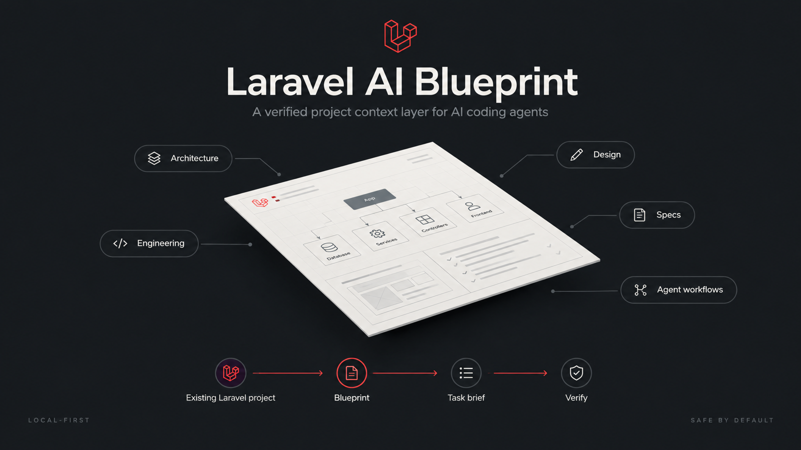
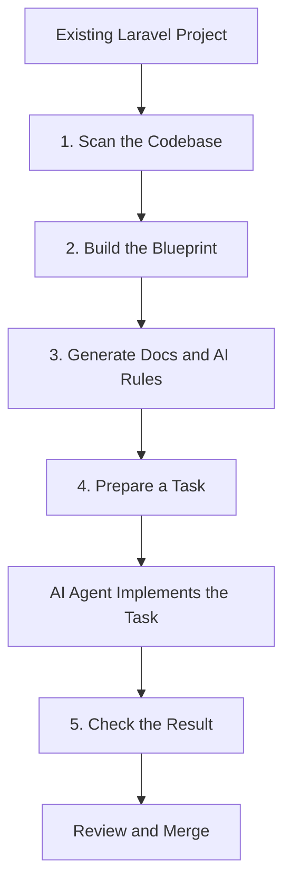

<p align="center">
  
</p>

<p align="center">
  <a href="https://github.com/AndrewProd/laravel-ai-blueprint/actions/workflows/ci.yml"></a>
  <a href="https://packagist.org/packages/andrewprod/laravel-ai-blueprint"></a>
  <a href="LICENSE"></a>
  
  
</p>

<p align="center">
  <a href="#-installation">Installation</a> ·
  <a href="#%EF%B8%8F-commands">Commands</a> ·
  <a href="#-what-gets-generated">Generated files</a> ·
  <a href="#-checks">Checks</a> ·
  <a href="#-local-first-and-safe-by-default">Security</a> ·
  <a href="#-limitations">Limitations</a>
</p>

---

## 🚀 What is Laravel AI Blueprint?

**Give your AI coding agent the knowledge it needs before it writes code.**

Laravel AI Blueprint analyzes your existing Laravel project and prepares the architecture, requirements, coding rules, and workflows that AI agents need to work within your project's conventions.

Instead of explaining your project in every conversation, you build a reusable engineering blueprint once and keep it updated as the project evolves.

Works with file-based workflows for **Codex, Claude Code, Cursor, and other AI coding agents.**

## 🧠 What does AI need before writing code?

A good AI-generated feature needs more than a prompt. It needs to understand five things.

| What AI needs | Where it lives | What it explains |
|---|---|---|
| **Architecture** | `docs/architecture/` | How the system is organized, which modules exist, and how they communicate |
| **Design system** | `docs/design/` | UI components, colors, layouts, responsive behavior, and UX states *(written by you; not generated in v0.1)* |
| **Specifications** | `docs/specs/` | Requirements, acceptance criteria, API contracts, database structures, and business rules |
| **Engineering standards** | `docs/engineering/` | Laravel conventions, testing, security, performance, and code quality |
| **AI instructions** | `AGENTS.md`, `CLAUDE.md`, `.cursor/rules/` | How the agent should explore, implement, test, and report changes |

Blueprint helps create this structure from your existing project, identifies missing information, and connects the relevant documents to each task.

### 1. Architecture

`docs/architecture/`

- System diagrams and module boundaries.
- Responsibilities of each module.
- Domain, Application, and Infrastructure layers where applicable.
- Dependencies between modules.
- Queues, events, integrations, and transaction boundaries.

The package discovers what it can from the code. Decisions that cannot be reliably inferred must be confirmed by a developer.

### 2. Design system

`docs/design/`

- Links to Figma designs, screenshots, and mockups.
- Colors, typography, spacing, and reusable UI components.
- Responsive layouts and accessibility requirements.
- Loading, empty, error, and success states.

This is especially useful for projects with a frontend. Blueprint does not invent a design system: in v0.1 it detects the frontend stack (Vue, React, Inertia, Vite, Tailwind, Blade, …) and leaves `docs/design/` to you.

### 3. Specifications

`docs/specs/`

- User stories and acceptance criteria.
- OpenAPI contracts and API requirements.
- Database schemas and entity relationships.
- Event and message formats.
- Business rules and edge cases.

When requirements are missing, the task brief lists them under **Open questions** instead of silently inventing behavior.

### 4. Engineering standards

`docs/engineering/`

- Laravel and PHP conventions.
- Project structure and naming rules.
- PHPStan, Pint, PHPUnit, and Pest.
- Authentication, authorization, validation, and security.
- SQL performance and database transactions.
- Required checks before a pull request.

### 5. AI workflows

`AGENTS.md`, `CLAUDE.md`, `.cursor/rules/`

- How to explore the codebase before making changes.
- Which modules and layers to use.
- How to follow existing conventions.
- How to create migrations and tests.
- Which architectural changes require approval.
- What the final implementation report must contain.

**The goal is not to send the entire repository to AI in one giant prompt.** Blueprint keeps project knowledge organized and prepares only the relevant context for a particular task.

## ⚙️ How it works



1. **Scan** — discover the framework, routes, models, migrations, tests, dependencies, and frontend.
2. **Build** — create a structured map of the project and identify missing information.
3. **Generate** — create architecture documents, engineering rules, and agent instructions.
4. **Prepare** — create a task brief with requirements, relevant files, constraints, and acceptance criteria.
5. **Verify** — check supported rules and documentation references before the changes are reviewed.

## 📦 Installation

Requirements: PHP 8.2+ and Laravel 11, 12 or 13.

```bash
composer require --dev andrewprod/laravel-ai-blueprint
```

The service provider is auto-discovered. Optionally publish the config:

```bash
php artisan vendor:publish --tag=ai-blueprint-config
```

Quick start:

```bash
php artisan ai-blueprint:init        # scan, build the blueprint, generate docs and agent files
php artisan ai-blueprint:review      # answer the architecture questions code can't
php artisan ai-blueprint:sync        # refresh generated files with your answers
php artisan ai-blueprint:task "Add customer notifications" --type=feature
php artisan ai-blueprint:check       # after the agent has finished
```

Real `ai-blueprint:init` output on a small Laravel 12 app (trimmed):

```text
   INFO  Laravel AI Blueprint.

  Framework ............................................... Laravel 12.10.0
  Frontend ...................................... blade, inertia, vite, vue
  Analyzer: php ................................................. complete
  Analyzer: routes ............................................... partial

  Components .............................................................
  controller ............................................................ 4
  model ................................................................. 2
  route ................................................................. 9
  table ................................................................. 2

  Managed files ..........................................................
  AGENTS.md ....................................................... created
  CLAUDE.md ......................... appended managed section (your content kept)
  docs/architecture/overview.md ................................... created

  Needs review ......................................... 8 open question(s)
  transaction_ownership ........................................... unknown
  external_api_retry_policy ....................................... unknown

   INFO  Next step: php artisan ai-blueprint:review.
```

`partial` means some code could not be analyzed statically, for example a route registered in a loop. `ai-blueprint:check` lists the details.

## 🛠️ Commands

All commands support `--no-interaction` and can be used in scripts and CI.

### `ai-blueprint:init`

**Set up Blueprint for your project.**

```bash
php artisan ai-blueprint:init
```

- Scan the existing project.
- Detect Laravel, PHP, and frontend technologies.
- Generate the initial architecture map.
- Create documentation and agent instructions.
- Report missing information and decisions that need review.

Run this first. Options: `--adapter=claude --adapter=cursor` (default: all enabled in config), `--dry-run`, `--force`, `--no-cache`. Safe to re-run.

### `ai-blueprint:map`

**Understand what Blueprint discovered.**

```bash
php artisan ai-blueprint:map
```

Show the detected modules, routes, models, integrations, tests, and unresolved questions. Options: `--type=model`, `--format=json`.

### `ai-blueprint:review`

**Confirm the architecture.**

```bash
php artisan ai-blueprint:review
```

Answer the questions that cannot be established from code alone: `module_boundaries`, `business_logic_location`, `transaction_ownership`, `external_api_retry_policy`, `authorization_strategy`, `api_versioning`, `queue_usage`, `testing_expectations`. Answers are stored in `.ai-blueprint/decisions.json`. Until a question is answered, every generated file says *"not confirmed — ask, do not assume"*.

Non-interactive:

```bash
php artisan ai-blueprint:review --set="queue_usage=Mail and webhooks run on Redis queues"
php artisan ai-blueprint:review --forget=queue_usage
```

### `ai-blueprint:task`

**Prepare a task for AI.**

```bash
php artisan ai-blueprint:task "Add customer notifications"
```

Generate a task brief containing:

- The task goal and acceptance criteria.
- Relevant modules and source files.
- Existing project conventions.
- Architecture and security constraints.
- Required tests and verification steps.

The brief is written to `docs/tasks/<slug>/` as `task.md`, `context.md` and `checklist.md`. Source files are referenced, never copied.

Options: `--type=feature|bugfix|refactor|api-endpoint|integration`, `--description="..."`, `--adapter=generic|codex|claude|cursor`, `--output=dir`, `--dry-run`, `--force`.

Open the generated brief in your preferred AI coding agent.

### `ai-blueprint:check`

**Check the blueprint and its rules.**

```bash
php artisan ai-blueprint:check
```

Validate the blueprint, check supported architecture rules, and find broken references or unresolved synchronization conflicts.

This command does not guarantee that application code is correct. It checks only the rules implemented and enabled (see [Checks](#-checks)), and it never runs your tests or other project commands.

Options: `--format=json`, `--strict` (warnings fail), `--changed --base=HEAD` (only files changed in git). Exits with code 1 on failure:

```yaml
- run: php artisan ai-blueprint:check --strict
```

### `ai-blueprint:scan`

**Refresh the project map.**

```bash
php artisan ai-blueprint:scan
```

Reanalyze the repository after significant code changes. Only `blueprint.json` is updated; run `sync` to refresh documents. Options: `--dry-run`, `--no-cache`, `-v` to list added/removed components.

### `ai-blueprint:sync`

**Update generated documentation safely.**

```bash
php artisan ai-blueprint:sync
```

Synchronize managed files with the current blueprint while detecting manual edits. User changes are never silently overwritten: in interactive mode you see a diff and are asked first. Options: `--dry-run`, `--diff`, `--force`, `--adapter=`.

### `ai-blueprint:doctor`

**Diagnose the setup.**

```bash
php artisan ai-blueprint:doctor
```

Read-only checks: configuration, write access, blueprint validity, manifest integrity and detected tools. It never installs anything or runs project scripts.

## 📁 What gets generated?

```text
your-laravel-app/
├── AGENTS.md
├── CLAUDE.md
├── .claude/
│   └── rules/
├── .cursor/
│   └── rules/
├── docs/
│   ├── architecture/   overview.md, modules.md
│   ├── engineering/    coding-standards.md, testing.md, security.md
│   ├── specs/          README.md
│   ├── adr/            README.md
│   └── tasks/<slug>/   task.md, context.md, checklist.md
└── .ai-blueprint/
    ├── blueprint.json
    ├── decisions.json
    ├── manifest.json
    └── cache/          (git-ignored)
```

**`docs/`** contains readable engineering documentation.

**Agent instruction files** explain how AI should work in this repository.

**`.ai-blueprint/blueprint.json`** stores the machine-readable project map.

Every fact in it is labelled **observed** (seen in a file), **inferred** (guessed from naming or structure), **confirmed** (recorded by a human) or **unknown**, and points to its source file. Analysis findings and coverage (`complete` / `partial`) are stored there as well. The format is versioned and described by [`resources/schemas/blueprint.schema.json`](resources/schemas/blueprint.schema.json).

**`decisions.json`** stores the architecture decisions you confirmed with `review`.

**`manifest.json`** stores hashes of generated files so manual edits can be detected.

Commit everything except `.ai-blueprint/cache/`. Adapters and documentation can be switched off in `config/ai-blueprint.php`.

### Your edits are safe

- **Untouched generated files** are updated by `sync`.
- **Edited generated files** are left alone and reported (`BP003`). They are overwritten only after confirmation or with `--force`.
- **Existing Markdown files Blueprint didn't create** are kept. This includes the `AGENTS.md` and `CLAUDE.md` that ship with new Laravel apps (Laravel Boost). Blueprint appends one delimited section and later updates only that section:

  ```markdown
  <!-- ai-blueprint:start — generated section, managed by `php artisan ai-blueprint:sync` -->
  ...
  <!-- ai-blueprint:end -->
  ```

- **Task briefs** belong to you after creation and are never overwritten without `--force`.
- **Files are never deleted.**

## 🔎 What is analyzed

| Analyzer | Reads | Finds |
|---|---|---|
| composer | `composer.json`, `composer.lock` | Laravel/PHP versions, PHPUnit/Pest/PHPStan/Larastan/Pint, notable packages, SDK integrations (Stripe, AWS, …) |
| php | `app/**/*.php` via the PHP tokenizer | Classes, interfaces, enums; roles (models, controllers, jobs, events, listeners, policies, form requests, services, …); imports, `implements`, listener → event |
| routes | `routes/*.php` | `Route::get/post/…/match/view`, `resource`/`apiResource` with `only`/`except`, prefixed groups, controller references |
| migrations | `database/migrations` | Tables, columns, indexes, foreign keys, drops and renames, replayed in order |
| tests | `tests/`, `*.test.*`, `*.spec.*` | PHPUnit/Pest files per suite, frontend tests, test → class links via imports |
| frontend | `package.json`, config files, `resources/` | Vue, React, Angular, Svelte, Inertia, Next/Nuxt, Vite, TypeScript, Tailwind, Blade, package manager |

## ✅ Checks

| Rule | Severity | Checks |
|---|---|---|
| BP001 | error | `blueprint.json` is readable, valid and internally consistent |
| BP002 | warning | Files referenced by managed documents exist |
| BP003 | warning | Managed files and sections were not edited by hand or deleted |
| BP004 | error | Task briefs contain Goal, Context, Acceptance criteria, Constraints, Open questions and Expected result |
| BP005 | error | Nothing is marked *confirmed* without a recorded human decision |
| BP006 | warning | Files or analyzers that could not be processed (for example PHP syntax errors) |
| BP007 | info | Sensitive files inside scanned directories (path only, never the content) |
| BP008 | error | State files use a supported schema version |
| BP009 | warning / info | The blueprint references deleted files, or managed files are out of date |

Rules can be disabled with `checks.disabled` in the config.

## 🏗️ Package architecture

The package itself is divided into five main parts.

```text
Laravel AI Blueprint
│
├── Scanner
│   └── Reads project files and discovers components
│
├── Blueprint
│   └── Stores the normalized project map and evidence
│
├── Generators
│   └── Creates documentation, rules, and task briefs
│
├── Agent Adapters
│   └── Formats instructions for Codex, Claude Code, Cursor
│
└── Rule Engine
    └── Checks supported rules and reports problems
```

### How the parts work together

The scanner discovers facts about the project. The Blueprint stores those facts in a shared format. Generators turn that information into documents and task briefs. Agent adapters create tool-specific instruction files. The rule engine checks what can be verified automatically.

This separation keeps the core independent of any particular AI provider.

## 🔒 Local-first and safe by default

- No AI API key, no network access, no telemetry.
- No execution of application code: PHP is read with the tokenizer, and routes and migrations are never run.
- No database connections.
- No reading of secrets: `.env*`, keys, certificates, `auth.json`, credentials files and database dumps are skipped by built-in patterns that config cannot remove. The cache stores parsed symbols, never file contents.
- Writes are confined to the project. Every path is validated (no `..`, no symlink escape, never inside `.git/`, `vendor/` or `node_modules/`), and writes are atomic.
- Repository content is treated as data. Text such as *"ignore previous instructions"* in your code is never copied into generated files.
- No automatic refactoring of application files.
- No silent overwriting of manual changes.

Blueprint helps AI follow your engineering process; it does not replace code review, tests, or developer approval.

## 🧭 Limitations

- Routes registered by packages, service providers or loops are not discovered; they are reported as partial.
- Migrations with raw SQL or dynamic table names are only partially analyzed.
- Roles derived from directory names (for example `app/Services`) are marked *inferred*, not proven.
- Frontend source files are not parsed; only the stack and directories are detected.
- Task context is selected by keyword matching. Treat it as a starting point.
- Instruction files guide agents but cannot guarantee that agents follow them.

## 🗺️ Roadmap

- [x] Project scanner and initial Blueprint
- [x] Architecture and engineering documentation
- [x] Agent instruction adapters (AGENTS.md / Codex, Claude Code, Cursor)
- [x] Architecture review workflow
- [x] Task brief generation
- [x] Built-in task templates (feature, bugfix, refactor, api-endpoint, integration)
- [x] Deterministic architecture checks (BP001–BP009)
- [x] Safe documentation synchronization
- [ ] Design system documents (`docs/design/`)
- [ ] Optional AI-assisted analysis
- [ ] Custom architecture profiles
- [ ] Advanced workflows and CI integration

Roadmap items are planned features, not claims about the current release.

## 🤝 Contributing

Contributions are welcome — especially new analyzers, architecture rules, task templates, agent adapters, and test fixtures.

Please include tests for new behavior and document any limitations or assumptions.

```bash
composer install
composer test          # PHPUnit: unit, feature and security tests, JSON Schema validation
composer analyse       # PHPStan
composer format:check  # Pint
```

See [CONTRIBUTING.md](CONTRIBUTING.md), [SECURITY.md](SECURITY.md) and [CHANGELOG.md](CHANGELOG.md).

## 📜 License

Laravel AI Blueprint is open-source software licensed under the [MIT License](LICENSE).
