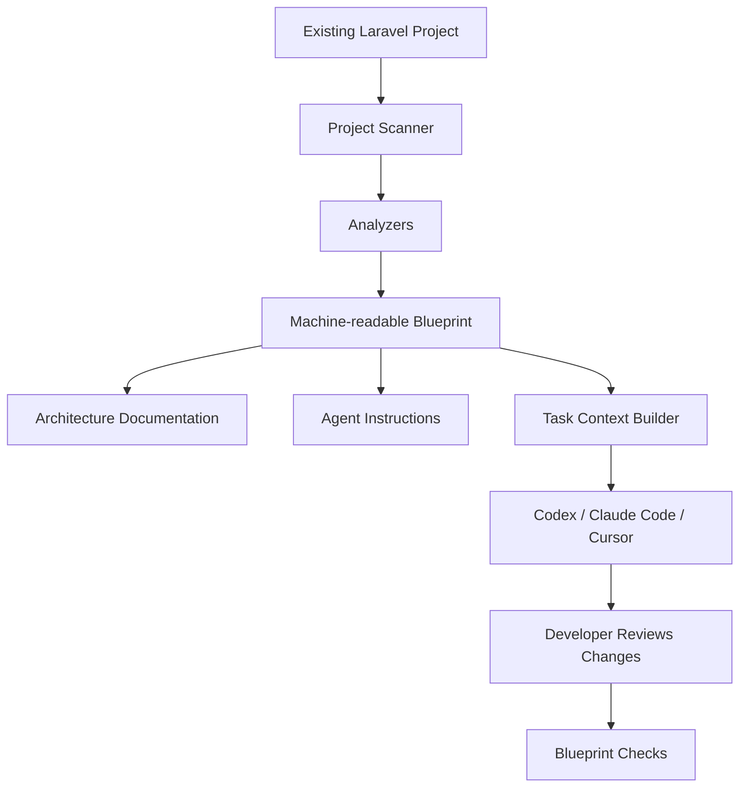

# Laravel AI Blueprint

<p align="center">
  <strong>Give AI coding agents an engineering blueprint for your Laravel project.</strong>
</p>

<p align="center">
  Architecture awareness · Project context · Engineering rules · Verifiable changes
</p>

<p align="center">
  <a href="LICENSE"></a>
  
  
  
  
</p>

<p align="center">
  <a href="#-why">Why</a> ·
  <a href="#-how-it-works">How it works</a> ·
  <a href="#-installation">Installation</a> ·
  <a href="#-commands">Commands</a> ·
  <a href="#-architecture">Architecture</a> ·
  <a href="#-roadmap">Roadmap</a> ·
  <a href="#-contributing">Contributing</a>
</p>

---

## 🚀 What is Laravel AI Blueprint?

AI coding agents can write code. But in a real Laravel project, writing code is only part of the job.

An agent also needs to understand your architecture, existing conventions, module boundaries, API contracts, security requirements, and testing strategy.

Without that context, developers repeatedly explain the same things, agents reinvent existing solutions, and architectural decisions get lost between tasks.

**Laravel AI Blueprint turns your existing Laravel repository into a structured engineering knowledge base for AI-assisted development.**

It scans your project, builds a machine-readable architecture map, generates documentation and agent instructions, prepares task-specific context, and checks the resulting changes against configurable rules.

Think of it as an **engineering blueprint for AI coding agents** — not another prompt generator.

## 💡 Why?

Without a project-aware workflow:

- AI agents repeatedly rediscover the same codebase.
- New features are implemented inconsistently.
- Architecture decisions exist only in developers' heads.
- Important requirements get lost in long conversations.
- Tests and security constraints are easy to overlook.
- Documentation becomes outdated or disconnected from implementation.

With Laravel AI Blueprint, the project itself becomes the source of reusable engineering context.

| Without Blueprint | With Blueprint |
|---|---|
| Explain the architecture repeatedly | Reusable project knowledge |
| Let the agent guess module boundaries | Documented and reviewable boundaries |
| Write every task prompt from scratch | Structured, context-aware task briefs |
| Hope the agent follows conventions | Explicit engineering rules |
| Manually rediscover relevant files | References to discovered components |
| Trust the final AI summary | Run independent checks |

## ✨ Core features

### 🗺️ Project architecture mapping

Discover the structure of an existing Laravel application:

- Composer dependencies and framework configuration
- Routes and controller references
- Models and database migrations
- Jobs, events, listeners, and queues where detectable
- Test directories and testing tools
- Frontend stack and project configuration
- References between discovered components

The scanner distinguishes directly observed facts from inferred relationships and decisions that still require confirmation.

### 🧠 Persistent engineering context

Generate a reusable knowledge base containing:

- Architecture overview
- Module and component map
- Engineering conventions
- Testing guidelines
- Security requirements
- Architecture decision records
- Task specifications and acceptance criteria

The goal is not to generate as much documentation as possible. It is to create useful, traceable context that helps an agent make better changes.

### 🤖 AI coding agent instructions

Generate project instructions for supported file-based workflows, including:

- OpenAI Codex
- Claude Code
- Cursor
- Other agents that support repository instruction files

The core blueprint remains agent-neutral. Adapters translate the shared project knowledge into the appropriate instruction-file format.

Blueprint does not require a proprietary agent API or an AI provider account.

### 🧩 Ready-made engineering workflows

Start tasks with a consistent process instead of an empty prompt.

Planned built-in workflows:

- Feature development
- Bug fixing
- Refactoring
- API endpoint implementation
- External integrations and webhooks

Each workflow can include context, acceptance criteria, constraints, implementation guidance, and a verification checklist.

### ✅ Architecture and documentation checks

Run deterministic checks against the blueprint and managed files.

Examples:

- Invalid or outdated blueprint data
- Broken references in generated documentation
- Missing required task sections
- Unresolved conflicts with manually edited generated files
- Unsupported or partially analyzed project structures

Checks report what they can verify. They do not claim that an application is secure or correct merely because its documentation exists.

### 🔒 Local-first by design

The MVP is designed to work locally inside your repository.

- No mandatory AI API key
- No automatic source-code uploads
- No production database connection
- No application-code execution during scanning
- No automatic application refactoring
- No silent overwriting of manual edits

Your codebase remains under your control.

## 🔄 How it works



### 1. Initialize

Scan the repository and create the first blueprint.

### 2. Review

Confirm architectural decisions that cannot reliably be inferred from source code alone.

### 3. Prepare a task

Build a structured task brief with relevant project context and constraints.

### 4. Develop with your preferred agent

Use the generated instructions and task brief in your existing AI coding workflow.

### 5. Verify

Run checks and review the resulting changes before merging.

**No mandatory agent orchestration. No lock-in to a single AI provider.**

## 📦 Installation

The package is intended to be installed into an existing Laravel application.

```bash
composer require --dev your-vendor/laravel-ai-blueprint
```

> Replace `your-vendor` with the actual published Packagist vendor name once the package is released.

Initialize the project:

```bash
php artisan ai-blueprint:init
```

Inspect the discovered architecture:

```bash
php artisan ai-blueprint:map
```

Prepare a task:

```bash
php artisan ai-blueprint:task "Add customer notifications"
```

Check the blueprint and its configured rules:

```bash
php artisan ai-blueprint:check
```

Refresh the discovered information and synchronize managed files:

```bash
php artisan ai-blueprint:scan
php artisan ai-blueprint:sync
```

The commands and flags above describe the intended MVP interface. Confirm their implementation and availability in the published release before relying on them in automation.

## 🖥️ Example output

The intended initialization experience:

```text
Laravel AI Blueprint

  Project detected
  ──────────────────────────────────────
  Framework       Laravel
  Backend         PHP
  Frontend        Vue / Vite
  Dependencies    Analyzed
  Routes          Analyzed
  Migrations      Analyzed
  Tests           Discovered

  Blueprint
  ──────────────────────────────────────
  Architecture    Generated
  Engineering     Generated
  Agent rules     Generated
  Project index   Created

  Needs review
  ──────────────────────────────────────
  Module boundaries
  Transaction ownership
  External API retry policy

  Next step
  ──────────────────────────────────────
  php artisan ai-blueprint:review
```

*Illustrative output, not a screenshot from a released implementation.*

## 📁 Generated project structure

The generated files depend on the project and the selected agent adapters.

```text
your-laravel-app/
├── AGENTS.md
├── CLAUDE.md
├── .claude/
│   └── rules/
├── .cursor/
│   └── rules/
├── docs/
│   ├── architecture/
│   │   ├── overview.md
│   │   └── modules.md
│   ├── engineering/
│   │   ├── coding-standards.md
│   │   ├── testing.md
│   │   └── security.md
│   ├── specs/
│   └── adr/
└── .ai-blueprint/
    ├── blueprint.json
    ├── findings.json
    ├── rules.json
    └── manifest.json
```

### What belongs where?

| Location | Purpose |
|---|---|
| `AGENTS.md` | General agent instructions |
| `CLAUDE.md` | Claude Code project instructions |
| `.claude/rules/` | Additional Claude Code rules |
| `.cursor/rules/` | Cursor-specific rules |
| `docs/architecture/` | Human-readable architecture knowledge |
| `docs/engineering/` | Coding, testing, and security standards |
| `docs/specs/` | Requirements and task specifications |
| `docs/adr/` | Architecture decision records |
| `.ai-blueprint/blueprint.json` | Machine-readable project model |
| `.ai-blueprint/manifest.json` | Tracking of generated and managed files |

The generated file formats should follow the official conventions of each supported tool. Not every project needs every directory.

## 🧱 Architecture

Laravel AI Blueprint separates project analysis, the engineering model, artifact generation, and agent-specific output.

```text
Artisan Commands
       |
Application Services
       |
Project Scanner
       |
Analyzers
       |
Normalized Blueprint
       |
       +-- Documentation Generators
       +-- Agent Adapters
       +-- Task Context Builder
       +-- Rule Engine
       |
Managed Files and Reports
```

### Design principles

**Agent-neutral core**  
The shared blueprint is independent of any one coding agent.

**Evidence-based analysis**  
Discovered facts should point to their sources. Inferred relationships must not be presented as confirmed decisions.

**Human-owned architecture**  
Developers approve important architectural choices instead of having a tool impose a methodology.

**Safe synchronization**  
Manual edits are detected and preserved unless the developer explicitly approves overwriting them.

**Small, composable analyzers**  
New project analyzers and rules can be added without redesigning the entire package.

## 🛡️ Security model

AI-assisted development needs guardrails that are useful in practice.

The MVP is designed around these defaults:

- Sensitive environment files are excluded from scanning.
- Dependency and generated directories are excluded by default.
- The scanner does not execute application code.
- The package does not connect to application databases.
- The package does not transmit repository data to external services.
- Generated paths are validated before writing.
- Existing user content is not silently overwritten.
- Project files are treated as data, not as trusted instructions to the package.
- External test or analysis commands require explicit configuration or invocation.

Blueprint is an engineering aid, not a security certification. Application security still requires appropriate code review, testing, and operational controls.

## 🧪 Testing and quality

The project should maintain automated coverage for:

- Blueprint serialization and schema validation
- PHP and Laravel project scanning
- Frontend detection
- Task brief generation
- Architecture rules
- Path traversal prevention
- Sensitive-file exclusion
- Synchronization conflicts
- Non-interactive CLI usage
- Partial analysis and malformed source files

CI should verify the supported PHP/Laravel matrix, static analysis, formatting, and package installation in a test Laravel application.

## 🗺️ Roadmap

The roadmap is intentionally incremental.

- [ ] Composer package and Artisan integration
- [ ] Initial project scanner
- [ ] Machine-readable blueprint schema
- [ ] Architecture and engineering documentation
- [ ] Generic agent instructions
- [ ] Codex adapter
- [ ] Claude Code adapter
- [ ] Cursor adapter
- [ ] Task brief generation
- [ ] Built-in workflow templates
- [ ] Deterministic blueprint checks
- [ ] Safe synchronization of managed files
- [ ] Expanded architecture analysis
- [ ] Optional LLM-assisted documentation
- [ ] Custom architecture profiles
- [ ] CI policy integration
- [ ] Optional multi-agent workflows

Roadmap items are plans, not claims that those features already exist. Update this checklist as features are implemented and released.

## 🧭 Scope and limitations

The initial release focuses on Laravel repositories and file-based agent instructions.

- Static scanning cannot discover every runtime-generated route or dynamic dependency.
- Source code alone cannot reliably reveal all business rules.
- Frontend detection does not imply deep analysis of every frontend framework.
- Agent instruction files guide behavior but do not guarantee compliance.
- Architecture checks only cover rules that are actually implemented and enabled.
- Full AI orchestration and external model integrations are outside the initial scope.

The package should report uncertainty rather than invent architectural facts.

## 🤝 Contributing

Contributions are welcome.

Useful areas to contribute:

- Laravel project analyzers
- Frontend detection
- Architecture rules
- Agent adapters
- Workflow templates
- Security and synchronization tests
- Documentation and example projects

Before opening a pull request:

1. Run the test suite.
2. Run static analysis and formatting checks.
3. Add tests for new behavior.
4. Document new rules and their limitations.
5. Avoid introducing mandatory network access or destructive file operations.

See [CONTRIBUTING.md](CONTRIBUTING.md) for the contribution process.

## 🗣️ Feedback and ideas

Have an idea for a workflow, analyzer, or architecture rule?

Open an issue with:

- The problem you want to solve
- An example Laravel project structure
- The expected behavior
- Any relevant security or compatibility constraints

Please do not include secrets, production credentials, or private application source code in public issues.

## 📜 License

Laravel AI Blueprint is open-source software licensed under the [MIT License](LICENSE).

---

<p align="center">
  <strong>Less repeated context. Better engineering workflows. More verifiable AI-generated changes.</strong>
</p>

<p align="center">
  If this project is useful to your workflow, consider giving it a ⭐ on GitHub.
</p>
